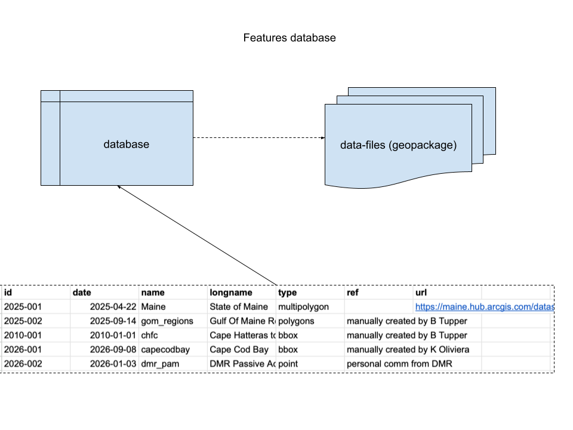

A lightweight database of spatial features. Following this conceptual design.


# Requirements

+ [R v4.2+](https://www.r-project.org/)
+ [rlang](https://CRAN.R-project.org/package=rlang)
+ [dplyr](https://CRAN.R-project.org/package=dplyr)
+ [readr](https://CRAN.R-project.org/package=readr)
+ [sf](https://CRAN.R-project.org/package=sf)
+ [uuid](https://CRAN.R-project.org/package=uuid)

# Installation

```
remotes::install_github("BigelowLab/features)
```

# Usage

## Set the root data path

Data are not stored within the package.  Instead there is a central repository of the data - here you set the path to that repository.

```{r}
library(features)
features::set_root_data_path()
```

## Read the database

The database is a simple data frame.
```{r}
db = read_database() |>
  dplyr::glimpse()
```

## Read a feature

Filter/slice the database to select the features you want to read. Features are *always* returned in a list.
```{r}
f = db |>
  dplyr::slice(1:2) |>
  read_feature() 
f
```

# Load feature into a database

You can also attach features to a database table as a new list column.

```{r}
y = load_feature(db)
y
```