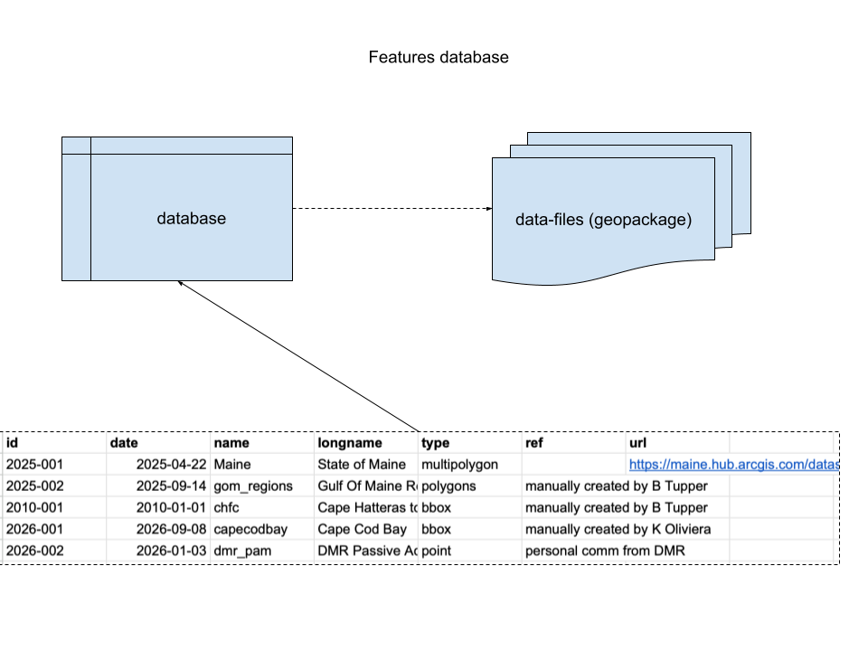

features
================

A lightweight database of spatial features. Following this conceptual
design.

 \# Requirements

- [R v4.2+](https://www.r-project.org/)
- [rlang](https://CRAN.R-project.org/package=rlang)
- [dplyr](https://CRAN.R-project.org/package=dplyr)
- [readr](https://CRAN.R-project.org/package=readr)
- [sf](https://CRAN.R-project.org/package=sf)
- [uuid](https://CRAN.R-project.org/package=uuid)

# Installation

    remotes::install_github("BigelowLab/features)

# Usage

## Set the root data path

Data are not stored within the package. Instead there is a central
repository of the data - here you set the path to that repository.

``` r
library(features)
features::set_root_data_path()
```

    ## [1] "/mnt/s1/projects/ecocast/coredata/features"

## Read the database

The database is a simple data frame.

``` r
db = read_database() |>
  dplyr::glimpse()
```

    ## Rows: 8
    ## Columns: 12
    ## $ id       <chr> "099326ba-d6d5-456c-8b54-fb20a7a52546", "a026eaef-1bd9-4a7c-9…
    ## $ date     <date> 2026-10-23, 2026-10-23, 2026-10-23, 2026-10-27, 2026-10-28, …
    ## $ name     <chr> "maine_lobster_zones", "maine_counties_dissolved", "maine_pol…
    ## $ longname <chr> "Maine Lobster Zones", "Maine County Boundary Polygons Dissol…
    ## $ type     <chr> "MULTIPOLYGON", "MULTIPOLYGON", "POLYGON", "POLYGON", "MULTIP…
    ## $ ref      <chr> "Maine Office of GIS", "Maine Office of GIS", "Maine Office o…
    ## $ url      <chr> "https://mainegeolibrary-maine.hub.arcgis.com/datasets/d33045…
    ## $ doi      <chr> NA, NA, NA, NA, NA, NA, NA, NA
    ## $ xmin     <dbl> -70.74121, -71.08392, -71.08392, -71.08015, -71.08392, -70.98…
    ## $ xmax     <dbl> -66.88574, -66.88544, -66.94942, -66.95141, -66.88544, -66.98…
    ## $ ymin     <dbl> 42.49748, 42.91714, 42.97703, 43.06517, 42.91714, 43.08590, 3…
    ## $ ymax     <dbl> 45.17117, 47.45986, 47.45986, 47.45991, 47.45986, 47.35484, 4…

## Read a feature

Filter/slice the database to select the features you want to read.
Features are *always* returned in a list.

``` r
f = db |>
  dplyr::slice(1:2) |>
  read_feature() 
f
```

    ## $`099326ba-d6d5-456c-8b54-fb20a7a52546`
    ## Simple feature collection with 7 features and 8 fields
    ## Geometry type: MULTIPOLYGON
    ## Dimension:     XY
    ## Bounding box:  xmin: -70.74121 ymin: 42.49748 xmax: -66.88574 ymax: 45.17117
    ## Geodetic CRS:  WGS 84
    ## # A tibble: 7 × 9
    ##   objectid zoneid created_user created_date        last_edited_user
    ##      <int> <chr>  <chr>        <dttm>              <chr>           
    ## 1        1 E      <NA>         NA                  MEDMR           
    ## 2        2 D      <NA>         NA                  MEDMR           
    ## 3        3 A      <NA>         NA                  MEDMR           
    ## 4        4 G      <NA>         NA                  MEDMR           
    ## 5        5 F      <NA>         NA                  MEDMR           
    ## 6        6 C      <NA>         NA                  MEDMR           
    ## 7        7 B      MEDMR        2019-08-28 11:28:51 MEDMR           
    ## # ℹ 4 more variables: last_edited_date <dttm>, Shape__Area <dbl>,
    ## #   Shape__Length <dbl>, geom <MULTIPOLYGON [°]>
    ## 
    ## $`a026eaef-1bd9-4a7c-943f-7d0300b1ae01`
    ## Simple feature collection with 16 features and 9 fields
    ## Geometry type: MULTIPOLYGON
    ## Dimension:     XY
    ## Bounding box:  xmin: -71.08392 ymin: 42.91714 xmax: -66.88544 ymax: 47.45986
    ## Geodetic CRS:  WGS 84
    ## # A tibble: 16 × 10
    ##    OBJECTID COUNTY    GlobalID created_user created_date        last_edited_user
    ##       <int> <chr>     <chr>    <chr>        <dttm>              <chr>           
    ##  1        1 Androsco… 5953fab… Emily.Petti… 2024-02-27 18:46:45 Emily.Pettit@ma…
    ##  2        2 Aroostook b7657d0… Emily.Petti… 2024-02-27 18:46:45 Emily.Pettit@ma…
    ##  3        3 Cumberla… 459bd87… Emily.Petti… 2024-02-27 18:46:45 Emily.Pettit@ma…
    ##  4        4 Franklin  5b528ca… Emily.Petti… 2024-02-27 18:46:45 Emily.Pettit@ma…
    ##  5        5 Hancock   07d2ddd… Emily.Petti… 2024-02-27 18:46:45 Emily.Pettit@ma…
    ##  6        6 Kennebec  4fd2919… Emily.Petti… 2024-02-27 18:46:45 Emily.Pettit@ma…
    ##  7        7 Knox      853eab1… Emily.Petti… 2024-02-27 18:46:45 Emily.Pettit@ma…
    ##  8        8 Lincoln   27f2a9e… Emily.Petti… 2024-02-27 18:46:45 Emily.Pettit@ma…
    ##  9        9 Oxford    c69a860… Emily.Petti… 2024-02-27 18:46:45 Emily.Pettit@ma…
    ## 10       10 Penobscot f574499… Emily.Petti… 2024-02-27 18:46:45 Emily.Pettit@ma…
    ## 11       11 Piscataq… 62f3a91… Emily.Petti… 2024-02-27 18:46:45 Emily.Pettit@ma…
    ## 12       12 Sagadahoc 5608e02… Emily.Petti… 2024-02-27 18:46:45 Emily.Pettit@ma…
    ## 13       13 Somerset  a2cc116… Emily.Petti… 2024-02-27 18:46:45 Emily.Pettit@ma…
    ## 14       14 Waldo     7b28f6d… Emily.Petti… 2024-02-27 18:46:45 Emily.Pettit@ma…
    ## 15       15 Washingt… df24189… Emily.Petti… 2024-02-27 18:46:45 Emily.Pettit@ma…
    ## 16       16 York      c17bdad… Emily.Petti… 2024-02-27 18:46:45 Emily.Pettit@ma…
    ## # ℹ 4 more variables: last_edited_date <dttm>, Shape__Area <dbl>,
    ## #   Shape__Length <dbl>, geom <MULTIPOLYGON [°]>

# Load feature into a database

You can also attach features to a database table as a new list column.

``` r
y = load_feature(db)
y
```

    ## # A tibble: 8 × 13
    ##   id         date       name  longname type  ref   url   doi    xmin  xmax  ymin
    ##   <chr>      <date>     <chr> <chr>    <chr> <chr> <chr> <chr> <dbl> <dbl> <dbl>
    ## 1 099326ba-… 2026-10-23 main… Maine L… MULT… Main… http… <NA>  -70.7 -66.9  42.5
    ## 2 a026eaef-… 2026-10-23 main… Maine C… MULT… Main… http… <NA>  -71.1 -66.9  42.9
    ## 3 f2c60c1c-… 2026-10-23 main… Maine S… POLY… Main… http… <NA>  -71.1 -66.9  43.0
    ## 4 65d3f90a-… 2026-10-27 main… Maine B… POLY… Main… http… <NA>  -71.1 -67.0  43.1
    ## 5 4647e333-… 2026-10-28 main… Maine E… MULT… Main… http… <NA>  -71.1 -66.9  42.9
    ## 6 1533a9b2-… 2026-10-28 main… Maine B… POINT Main… http… <NA>  -71.0 -67.0  43.1
    ## 7 1f0c0599-… 2026-11-02 gulf… Gulf of… MULT… Bath… <NA>  <NA>  -70.9 -65.7  40.0
    ## 8 9ddf6801-… 2026-11-02 main… Maine E… MULT… Main… http… <NA>  -71.1 -66.9  43.0
    ## # ℹ 2 more variables: ymax <dbl>, feature <named list>

# Add a new feature

New features results in additional rows in the database. At a minumum
you must provided a *name* (programmable! no spaces! short!), a *long
name* (for displays) and a *spatial object* either an `sf` object or a
file path to an object that can be read by `sf::read_sf()`. You can also
provides a reference, doi, etc.

    add_feature("casco_bay", "Casco Bay", path_to_file,
                ref = "Courtesy Casco Bay Yacht Club",
                url = "http://www.cbyc.org")
